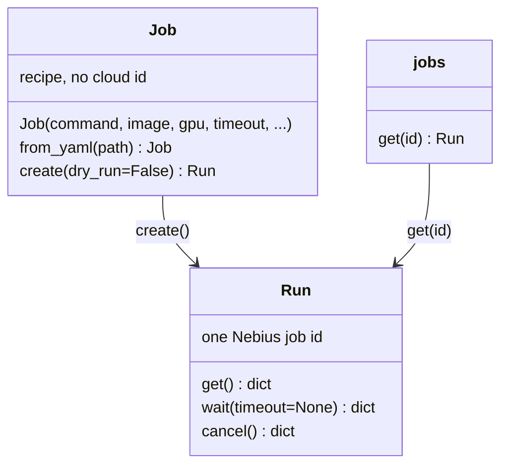

# Cloud Jobs slice — Python SDK contract

28 October 2026. Authoritative contract for the next prototype slice. This file lives in the prototype repo. It does not edit the YAPF-1739 documents.

Background, superseded where they disagree with this file:

- `prototype-v0-spec.md` — offline Jobs prototype. Its local subprocess runtime, fake image allowlist, `result()` manifest proof, and `submit` / `Run` naming are not this slice.
- `job-sdk-specs-draft.md` and `serveress-sdk-interfaces.md` — shared vocabulary. Spot-by-default, Hugging Face inputs, `Environment.from_project`, and `timeout=` as a shorthand alias are not this slice.
- `use-cases/02-batch-processing.md` — batch recovery ideas. The batch controller, `.map()`, and spot workers are not this slice.

The runtime is Nebius Serverless AI Jobs. A script sends a user image, a command, and a machine size. Nebius starts a container. The laptop does not run the job.

API facts below were checked against Nebius docs on 28 October 2026:

- [Jobs quickstart](https://docs.nebius.com/serverless/quickstart/jobs) — Python `JobServiceClient.create`, then `get` until `status.state` is terminal. Logs are documented for the web console and the CLI.
- [Manage jobs](https://docs.nebius.com/serverless/jobs/manage) — image tag or digest, timeout minimum 1 hour and maximum 168 hours, subnet required when the project has several, on-demand is the default when preemptible flags are omitted, disk default 250 GiB, `/dev/shm` default 16 GiB.
- [`nebius ai job`](https://docs.nebius.com/cli/reference/ai/job) — `create`, `get`, `cancel`, `list`, `logs`, `delete`, `restart`, `ssh`, `get-by-name`, `run`.
- [VM types](https://docs.nebius.com/compute/virtual-machines/types) — platform ids, regions, and the smallest preset used in the alias table.

## 1. Primitives

`Job` is a local recipe. It holds the same information as the flags of `nebius ai job create`. Constructing a `Job`, loading YAML, or importing the package performs no authentication, upload, or create.

`Run` is one cloud job after create. It is the only object with a Nebius job id. `get`, `wait`, and `cancel` sit on `Run` because they need that id. `Job` has no `cancel()`.

`ns.jobs` is the collection, matching the CLI noun `nebius ai job`. `ns.jobs.get(id)` is `nebius ai job get` when the script only kept a string id.



A second `create()` on the same `Job` starts another cloud job and returns another `Run`.

Modal and RunPod both put get and cancel on the execution that has an id. Modal’s function is a local recipe and `FunctionCall` is the id. RunPod’s endpoint already exists in the cloud, and `run()` only submits an input. This slice follows Nebius and Modal’s “recipe, then one id.” It does not add an endpoint object.

## 2. Script surface

Synchronous methods are the script API. The quickstart does not show `asyncio`.

```python
import nebius_serverless as ns

job = ns.Job(
    ["nvidia-smi"],
    image="nvidia/cuda:13.1.1-runtime-ubuntu24.04",
    gpu="h100",
    timeout="1h",
)
run = job.create()
print(run.id)
record = run.get()
record = run.wait()
run.cancel()
run = ns.jobs.get(saved_id)
```

YAML is the same recipe:

```python
job = ns.Job.from_yaml("job.yaml")
run = job.create()
```

There is no `submit()`, `plan()`, `result()`, or `refresh()`. There is no `Run` method named `get` that differs from `ns.jobs.get`. `run.get()` and `ns.jobs.get(run.id)` perform one `nebius ai job get`.

`create()` blocks until Nebius has accepted the job and the id is known, then returns the `Run`. It does not block for the container to finish.

`create(dry_run=True)` builds the create request, returns that description, and does not call create. The description includes image, command, args, project, region, platform, preset, timeout, pricing, subnet if set, volumes, env key names, and the generated name. It does not include env values.

### Async

Callers that already have an event loop use awaited twins: `create_async`, `get_async`, `wait_async`, `cancel_async`, and `ns.jobs.get_async`. They perform the same calls as the synchronous methods. Synchronous methods, when a loop is already running, raise `ValidationError` and tell the caller to use the awaited twin. The quickstart does not use the awaited twins.

## 3. `Job` fields

| Field | Required | Meaning |
| --- | --- | --- |
| `command` | yes | Nonempty list of strings. The first element is `container_command`. Further elements are sent as the single `args` string the Jobs API accepts. Each further element is POSIX-quoted (`shlex.quote`) and joined with spaces. A one-element command omits `args`. A shell string is rejected. |
| `image` | yes | `registry/path:tag` or `registry/path@sha256:<64 hex>`. The string is sent unchanged. The client does not resolve a tag to a digest. |
| `gpu` | no | Alias from the table below. Omit it, or pass `None`, for CPU. `gpu="cpu"` raises `ValidationError` and says to omit `gpu`. |
| `platform` | no | Explicit platform id. When set, it overrides `gpu`. |
| `preset` | no | Explicit preset id. When omitted, the client sends the minimal preset for the chosen platform. An unknown platform id requires `preset`. |
| `timeout` | yes | Job deadline. Duration string such as `"1h"`, seconds, or `timedelta`, normalized to seconds. Values below 1 hour or above 168 hours raise `ValidationError` before create. No rounding and no silent clamp. This is the Jobs `--timeout`, not a local wait. |
| `pricing` | no | `"on-demand"` (default) or `"spot"`. `"spot"` means preemptible and follow the current price. `"spot"` with CPU raises `UnsupportedFeature` before create. Other values raise `ValidationError`. |
| `subnet_id` | no | Sent when set. Omitted when the project has a single subnet. |
| `volumes` | no | List of strings in the CLI volume form, passed through: `source:container_path[:mode]` or `s3://bucket:/container_path[:mode[:profile]]`. The client does not verify objects. |
| `env` | no | `dict[str, str]` of environment variables. Values are sent on create and never copied into exceptions, plans, or logs emitted by this package. |
| `name` | no | Console label sent as `metadata.name`. When omitted, the client generates one. It is not a lookup key. |
| `disk` | no | CLI `--disk-size` string, passed through, such as `500Gi`. When omitted, the adapter sends 250 GiB. |

`execution_timeout=` is not a parameter. The deadline keyword is `timeout`, matching the CLI.

`/dev/shm` is not a parameter. The adapter sends 16 GiB.

## 4. GPU and CPU aliases

Presets are the smallest one-GPU size on that platform, or the smallest CPU preset. Source: [VM types](https://docs.nebius.com/compute/virtual-machines/types), 28 October 2026. The project region comes from the profile when it names one, otherwise from the project's `spec.region`. An alias whose platform is not in that region raises `ValidationError` before create and names the regions that have it.

| `gpu` | Region | Platform | Preset |
| --- | --- | --- | --- |
| `"h100"` | `eu-north1` | `gpu-h100-sxm` | `1gpu-16vcpu-200gb` |
| `"h200"` | `eu-north1`, `eu-north2`, `eu-west1`, `us-central1` | `gpu-h200-sxm` | `1gpu-16vcpu-200gb` |
| `"b300"` | `uk-south1`, `eu-west2`, `us-north1` | `gpu-b300-sxm` | `1gpu-24vcpu-346gb` |
| `"l40s"` | `eu-north1` | `gpu-l40s-a` | `1gpu-8vcpu-32gb` |
| `"b200"` | `us-central1` | `gpu-b200-sxm` | `1gpu-20vcpu-224gb` |
| `"b200"` | `me-west1` | `gpu-b200-sxm-a` | `1gpu-20vcpu-224gb` |
| `"rtx"` | `us-central1` | `gpu-rtx6000` | `1gpu-24vcpu-218gb` |
| `"rtx"` | `uk-south2`, `eu-south1` | `gpu-rtx6000-a` | `1gpu-24vcpu-218gb` |
| omitted | any public region | `cpu-d3` | `2vcpu-8gb` |

`l40s` is `gpu-l40s-a` because both L40S platforms are only in `eu-north1`, so the region cannot choose. `gpu-l40s-a` is the quickstart platform and its smallest machine is the smaller of the two. CPU is `cpu-d3` because that platform exists in every public region. `cpu-e2` is not selected.

`b200` and `rtx` each have one platform per region. A region with no row fails before create.

## 5. YAML

`Job.from_yaml(path)` loads schema version 1. The loader returns a command `Job`. A document whose execution selector is `function` raises `ValidationError`.

```yaml
schema_version: 1
kind: job
image: nvidia/cuda:13.1.1-runtime-ubuntu24.04
command: ["nvidia-smi"]
gpu: h100
timeout: 1h
pricing: on-demand
```

Allowed keys: `schema_version`, `kind`, `image`, `command`, `gpu`, `platform`, `preset`, `timeout`, `pricing`, `subnet_id`, `volumes`, `env`, `name`, `disk`. Unknown keys, duplicate keys, aliases, anchors, tags, merge keys, and a document over 1 MiB are rejected. `command` is a list of strings. A shell string is rejected. Relative paths are not expanded. `env` values are accepted and then treated like Python `env` values.

`gpu` may be omitted for CPU. `gpu: cpu` is rejected.

## 6. `Run` and `ns.jobs`

| Call | CLI | Behavior |
| --- | --- | --- |
| `job.create()` | `ai job create` | Returns a `Run` after the job id is known. |
| `run.get()` | `ai job get` | One fetch. Returns the job JSON: state plus submitted params. |
| `ns.jobs.get(id)` | `ai job get` | Same fetch, starting from an id string. Returns a `Run`. |
| `run.wait(timeout=None)` | none | Polls `get` until the state is terminal. Returns that JSON. |
| `run.cancel()` | `ai job cancel` | Requests cancellation. Returns when the request is accepted. Does not claim the container has stopped. |

`run.id` is the Nebius job id. Property reads do not perform I/O. The last fetched JSON is available as `run.record` after `get` or `wait`. `run.status` is the state field of that record. Before the first successful fetch after create, `status` is the state from the create response.

`wait(timeout=0)` performs one fetch and, when the state is not terminal, raises `WaitTimeout` with the job id. `wait(timeout=seconds)` stops the local poll. Neither form cancels the cloud job.

`FAILED`, `CANCELLED`, and a platform timeout are values in the job JSON. `get` and `wait` return that JSON. They do not raise because the container exited badly. There is no workload return value and no manifest proof.

Terminal states are whatever `status.state` the Jobs API uses for a finished job, including success, failure, and cancellation. The adapter preserves the raw state string. It does not invent a parallel enum.

## 7. Authentication and project

`create` and `get` use the active Nebius Python SDK profile and its project id. The region comes from that profile when it names one, otherwise from IAM v2 `Project.spec.region`. The package does not read arbitrary credential files itself and does not shell out to the `nebius` CLI.

Optional `profile=` and `project=` on `Job` select a profile or override the project. `region=` overrides the resolved region. Missing or ambiguous project configuration, or a project with no region, raises `ValidationError` before create. The package does not switch profile, project, or region after an error.

## 8. Create mapping

The adapter calls the official Python SDK `JobServiceClient.create` and waits for the create operation far enough to read `resource_id`. That wait is acceptance, not container completion.

| Recipe | Create request |
| --- | --- |
| `command[0]` | `spec.container_command` |
| quoted `command[1:]` | `spec.args`, omitted when absent |
| `image` | `spec.image` |
| resolved platform and preset | `spec.platform`, `spec.preset` |
| `timeout` | `spec.timeout` |
| `pricing="on-demand"` | on-demand. No preemptible flag. |
| `pricing="spot"` | preemptible and follow the spot price. No pricing-policy id. |
| `subnet_id` | `spec.subnet_id` when set |
| `volumes` | `spec` volume entries, passed through |
| `env` | container environment entries |
| `name` | `metadata.name` |
| profile project | `metadata.parent_id` |
| `disk` | disk size when set |
| defaults | disk 250 GiB when `disk` is omitted, shm 16 GiB |

The generated or caller-supplied `name` is stored on the `Run` as `run.name` for display. Lookup ignores it.

## 9. Identity and a lost response

The handle is the job id returned by create. The client persists nothing beyond what the caller keeps. `ns.jobs.get(id)` reloads that job.

If the create call may have reached Nebius and the id was not returned, `create()` raises `SubmissionUncertain`. The client does not send a second create, does not call get-by-name, and does not pick a job from a list. The caller finds an unsaved job in the console. A name collision or an API “already exists” error is `KeyConflict` when the existing id can be read from that error. Otherwise it stays `SubmissionUncertain`.

Closing the process, a local `WaitTimeout`, and cancelling an awaited twin do not cancel the cloud job. Only `run.cancel()` requests cancellation.

## 10. Errors

Exceptions are `nebius_serverless` types. They include the operation and the job id when known. They do not include env values, tokens, or registry passwords.

| Type | When |
| --- | --- |
| `ValidationError` | Bad command, image, timeout, alias, region mismatch, YAML, or a sync call inside a running event loop. |
| `UnsupportedFeature` | Spot on CPU, decorators, function YAML, secrets, and other commands excluded from this slice. |
| `AccessError` | Authentication or permission failure from the SDK. |
| `CapacityError` | The API rejected the job for quota or capacity. |
| `TransportError` | The call failed and there is no reason to think create was accepted. |
| `SubmissionUncertain` | Create may have been accepted and the id is unknown. |
| `KeyConflict` | The API reports an existing resource for this create and its id is known. |
| `WaitTimeout` | The local wait ended. The cloud job is unchanged. |

## 11. Out of this slice

- Decorators and `@app.function`. A leftover decorator `submit` raises `UnsupportedFeature` and tells the caller to use `Job.create()`.
- Function YAML.
- Secret references (`--env-secret`). Plain `env` is in the slice.
- `ns.jobs.list`, Python logs, `delete`, `restart`, `ssh`, and `get-by-name`.
- Hugging Face inputs, source upload, image build, and a local subprocess runtime.
- Batch controller, `.map()`, and manifest verification.
- Spot pricing-policy ids. Only follow-the-price spot.
- Endpoints and DevLabs.

Job logs remain `nebius ai job logs <id>`. The README states that command. The library does not spawn the CLI.

## 12. Package

The import name stays `nebius_serverless`. The distribution stays installable with pip. Public exports for this slice are `Job`, `jobs`, `Run`, and the errors in section 10. The dependency on the official Nebius Python SDK is required for a real create. Normalization tests run without credentials by injecting a fake transport. A missing SDK or a missing profile fails at `create()`, not at import, when the test transport is absent. `dry_run=True` still resolves the profile far enough to show project and region, and skips create.

`src/nebius_serverless`, `tests/`, and `examples/` follow PEP 8. Ruff is the check: pycodestyle, Pyflakes, import order, and a 79-character line. `ruff check src tests examples` passes before the slice is accepted. There is no formatter config that widens that line.

`__all__` is the public surface. Modules do not star-import. Public modules, classes, and functions have PEP 257 docstrings and PEP 484 annotations. The section 10 exception names stay as written.

The package is a `src` layout declared in `pyproject.toml`. `Job()` does not import the Nebius SDK. The SDK is imported on the call that needs it. Constructors and methods do not use mutable default arguments. Tests exercise the public surface.

## 13. Acceptance scenarios

The slice is accepted when the three scripts in `examples/acceptance/` succeed against an authorized project. Each script dry-runs unless it is passed `--create`. `--create` is the live run. The short job and the Axolotl job pass `gpu`. That alias resolves to the platform and preset from their cookbook commands. The line-count script uses `h100` unless `--gpu` says otherwise, and that alias must exist in the project region. `examples/quickstart.py` is the section 2 recipe.

A scenario succeeds when every `run.wait()` returns job JSON whose `status.state` is `COMPLETED`. The CLI documents that state for a successful job. The package does not upload objects and does not read them back. Where a scenario uses a bucket, the script talks to Object Storage with the AWS CLI. The endpoint is `https://storage.<region>.nebius.cloud`.

### 1. Short job

`examples/acceptance/nvidia_smi.py` matches the [first-job quickstart](https://github.com/nebius/serverless-ai-cookbook/blob/main/quickstarts/first-job.md) create command. It is one on-demand job.

| Field | Value |
| --- | --- |
| image | `nvidia/cuda:13.1.1-runtime-ubuntu24.04` |
| command | `["bash", "-c", "nvidia-smi"]` |
| gpu | `l40s` |
| platform | `gpu-l40s-a`, resolved from `l40s` |
| preset | `1gpu-8vcpu-32gb`, resolved from `l40s` |
| timeout | `1h` |
| name | `my-job` |

`command` is the quickstart's `--container-command bash --args "-c nvidia-smi"`. The quickstart passes `--timeout 15m`. The Jobs API minimum is 1 hour, so this client sends `1h` and does not clamp `15m` up. The script does not call get-by-name. It uses the id from `create()`.

`examples/acceptance/nvidia_smi.yaml` is the same recipe through `Job.from_yaml`. The live run uses the Python script. Offline, `from_yaml` and the constructor produce the same create request.

### 2. Axolotl fine-tune

`examples/acceptance/axolotl_lora.py` matches the [Axolotl cookbook](https://github.com/nebius/serverless-ai-cookbook/tree/main/templates/job-axolotl-finetune) create command. One spot GPU job. The shell downloads the cookbook Qwen2.5-0.5B config, trains it, and copies checkpoints to `/workspace/data/output/<run id>`.

| Field | Value |
| --- | --- |
| image | `docker.io/axolotlai/axolotl:main-20260309-py3.11-cu128-2.9.1` |
| command | `bash -lc` and the cookbook `--command` string |
| gpu | `h100` |
| platform | `gpu-h100-sxm`, resolved from `h100` |
| preset | `1gpu-16vcpu-200gb`, resolved from `h100` |
| pricing | `spot` |
| disk | `500Gi` |
| timeout | `24h` |

`spot` is `--preemptible --follows-spot-price`. Shared memory stays the 16 GiB adapter default, which is the cookbook `--shm-size 16Gi`. The cookbook omits `--timeout`. `24h` is that CLI default. The command does not mount a volume, because the published CLI does not pass `--volume`.

### 3. Three GPU jobs over 30 files

`examples/acceptance/line_count.py` prepares the data, then starts three jobs. This is three `Job.create()` calls. It does not add `.map()` or a batch controller.

The script writes 30 text files, 10 per shard:

| Shard | Files | Lines in each file | Report |
| --- | --- | --- | --- |
| `shard-0` | 10 | 100 | `1000` |
| `shard-1` | 10 | 200 | `2000` |
| `shard-2` | 10 | 300 | `3000` |

`--create` requires `ACCEPTANCE_BUCKET` and `NEBIUS_REGION`. The script uploads the files with the AWS CLI under a fresh prefix `acceptance/<timestamp>/input/<shard>/`. Each job mounts that bucket at `/data` with `s3://<bucket>:/data:rw` and counts lines in its own shard. The command is `python -c` on `python:3.12-slim`. The report object is `acceptance/<timestamp>/reports/<shard>.txt` and its body is the integer and a newline. `gpu` is the selected alias. `timeout` is `1h`.

The script creates all three jobs, then waits. The scenario succeeds when all three states are `COMPLETED` and the three objects read back as `1000`, `2000`, and `3000`. Cleanup of the jobs remains a manual `nebius ai job delete`. The script does not delete them.
